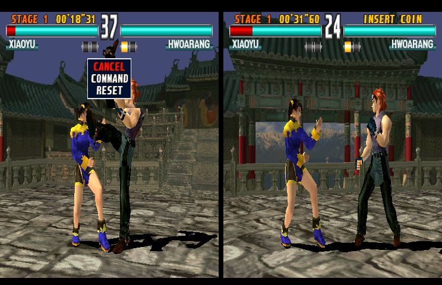

# Fase 3 — Etapa 3: vídeo (MDEC), controle do PS2 e PRIMEIRA LUTA

Xiaoyu × Hwoarang, Stage 1: cronômetro correndo, vida caindo, golpes. A
captura da esquerda tem o menu de pausa porque o teste automático aperta
START sem parar.

## 1. Controle do PS2 (runtime/controle_ps2.c)
rom0:SIO2MAN + rom0:PADMAN + libpad; a cada VBlank os botões vão para
`ps2_pad_botoes[0]` (layout igual ao do PS1). Digital por enquanto.

## 2. MDEC (runtime/mdec.c) — vídeos
Implementação completa pelo psx-spx: comandos 1 (decodificar), 2 (tabelas de
quantização) e 3 (tabela de escala); RLE + zigue-zague + IDCT em 2 passadas +
YUV→RGB; saídas de 4, 8, 15 e 24 bits. DMA0 alimenta, DMA1 lê (fica pendente
se ainda não há dados). A tela de 24 bits agora é convertida para exibição.
Teste: `tests/mdec_test.c`. Ver `FASE3_FMV_MDEC.png` ("Once again," da
abertura).

## 3. ENDX do SPU
Sem SPU emulado, o ENDX agora diz "todas as vozes terminaram". Com 0 o driver
de som achava que nada acabava.

## 4. A causa da lentidão do título e do cronômetro parado
Medição: **99 % do tempo do EE dentro do tratador de interrupção**.
A libgpu mantém uma fila de comandos: cada fim de DMA da GPU gera uma
interrupção que dispara a próxima lista (`DrawOTag`). No PS1 isso é barato,
porque a GPU desenha em paralelo. Aqui a rasterização roda no próprio EE e o
"fim de DMA" é imediato, então a tela inteira era desenhada dentro da
interrupção e o laço principal do jogo quase não rodava: o título levava 1–2
minutos para aceitar START e o cronômetro da seleção não descia.

**Solução: orçamento da GPU** (`io.c`, `ORCAMENTO_GPU = 50`). Cada lista
desenhada gera "dívida" igual ao tempo gasto; o tempo fora da GPU paga a
dívida. Com dívida, a lista seguinte só executa estado e transferências de
VRAM — preenchimentos (0x02) e primitivas (0x20–0x7F) são pulados (quadro
pulado). Resultado: interrupção ~51 %, lógica do jogo em velocidade normal,
menu logo depois do título.

## Desempenho atual (luta, PCSX2)
- ~200 listas a cada 120 VBlanks; ~83 % são puladas → poucos quadros
  desenhados por segundo. A lógica roda a 60, a imagem não.
- Rasterização de triângulos texturizados em software: ~175 ciclos do EE por
  pixel. **O próximo passo obrigatório é desenhar no GS (hardware)** — ou, no
  mínimo, otimizar muito o triângulo texturizado.

## Pendências
- Áudio (SPU, XA, CDDA).
- Analógico/vibração.
- GS em hardware.
