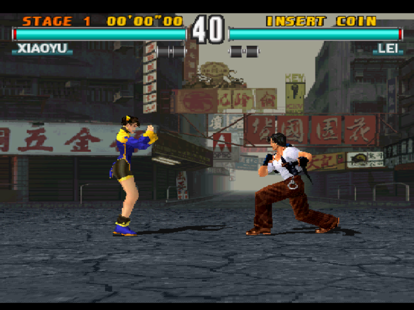
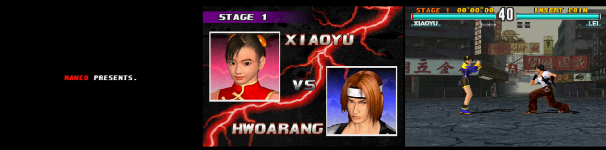

# Fase 4 — Desenho no GS (hardware do PS2)

## Como funciona (runtime/gs_render.c)

- **VRAM do PS1 dentro do GS:** buffer PSMCT16 de 1024×512 (1 MB). Os
  comandos da GPU do PS1 desenham direto nele, no **contexto 2** do GS
  (FRAME_2, TEX0_2...). O gsKit só inicializa a tela.
- **Coordenadas:** XYOFFSET de 2048 (o PS1 aceita vértices negativos);
  SCISSOR = área de desenho do PS1.
- **Primitivas:** polígonos → TRIANGLE STRIP (quadrados viram 2 triângulos),
  retângulos → SPRITE, linhas → LINE. Gouraud (IIP), modulação (MODULATE,
  0x80 = 1,0 nos dois) e textura "bruta" (DECAL).
- **Transparência do PS1:** ALPHA_2 com FIX: modo 0 (Cs−Cd)·0,5+Cd, modo 1
  Cs+Cd, modo 2 Cd−Cs, modo 3 Cs·0,25+Cd; COLCLAMP ligado. Em textura só os
  texels com bit 15 misturam: **TEXA** (bit 15 → alfa 0x80, senão 1; preto sem
  bit 15 → 0) + **PABE** + teste de alfa ≥ 1 (descarta o texel transparente).
- **Máscara:** FBA_2 (escreve bit 15) e DATE (não escreve sobre bit 15).
- **Dither:** DTHE + DIMX com a matriz do PS1 (gouraud com dither ligado).
- **Texturas de 15 bits:** lidas da própria VRAM no GS (REGION_CLAMP na página).
- **Texturas de 4/8 bits:** os índices de cada página (256×256) vão para um
  **cache** no GS (PSMT4/PSMT8, 20 fatias de 64 KB, LRU). A **CLUT é lida da
  VRAM no GS pelo modo CSM2** (TEXCLUT), então funciona mesmo se o jogo mudar
  a CLUT desenhando. Janela de textura → CLAMP REGION_REPEAT.
- **Invalidação:** uploads da CPU, preenchimentos e cópias marcam colunas de
  64 px × 256 linhas; a página do cache é reenviada só se mudou.
- **Uploads da CPU / preenchimento / cópia VRAM→VRAM:** vão para a sombra em
  RAM (usada pelo cache e pelas leituras) e para o GS (IMAGE / sprite /
  transferência local→local).
- **Exibição:** sprite da área exibida da VRAM para o buffer da tela, a cada
  VBlank. Modo de 24 bits (vídeos) continua pela sombra.
- **Fila:** pacotes A+D em 2 buffers de 512 KB enviados por DMA ao GIF.

## Achados no caminho

- O gsKit no modo entrelaçado **FRAME divide a altura por 2** (224 linhas
  exibidas dobradas). Agora: modo FIELD, 448 linhas reais.
- Na cópia para a tela é preciso zerar o CLAMP (senão herda o REGION_REPEAT
  da última textura do jogo).
- `make VER_VRAM=1` mostra a VRAM inteira na tela (diagnóstico).

## Desempenho (PCSX2)

| | software | GS |
|---|---|---|
| luta: listas desenhadas | ~17 % (83 % puladas) | **100 %** |
| interrupção | ~51 % (com pulo) | ~68 % |
| boot até a luta (AUTO_START, sem limitador) | ~110 s | **~18 s** |

O jogo roda a 60 quadros por segundo na luta (2 listas por VBlank). Interpretar
os comandos e montar os pacotes custa ~1300 ciclos do EE por polígono
(~2000 polígonos por VBlank); otimizar isso dá mais folga.

## Pendente

- Leituras VRAM→CPU (0xC0) vêm da sombra: não veem o que o GS desenhou.
- Páginas de 4/8 bits desenhadas pela GPU (render-to-texture) não entram no
  cache (só uploads/cópias).
- Sprites espelhados (bits 12/13 do E1), entrelaçado "só campo exibido".
